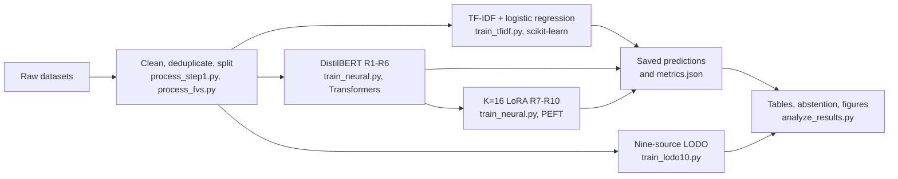
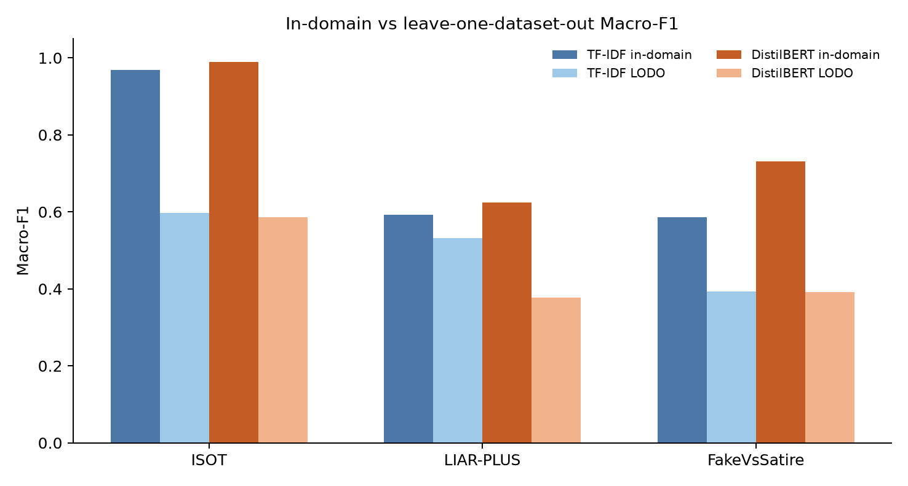
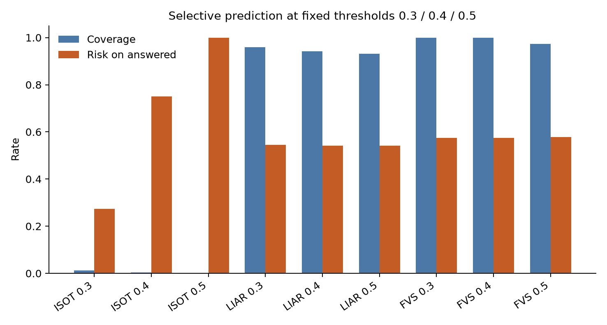
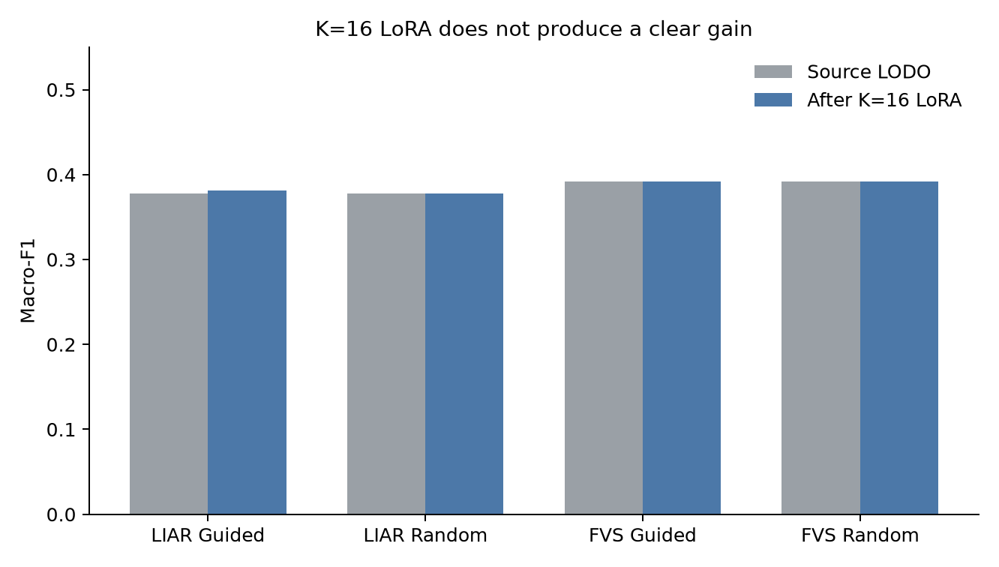

# Label-Semantics-Aware Cross-Domain Fake News Detection

**Lekhraj** and **Nageshwar Yadav**  
M.Tech, Artificial Intelligence and Machine Learning

| Paper | Slides | Main results | Figures |
|---|---|---|---|
| [IEEE_LODO_Conference.pdf](paper/IEEE_LODO_Conference.pdf) | [Project_Slides_8.pptx](slides/Project_Slides_8.pptx) | [Table 1](results/analysis/Table_1_InDomain.md), [Table 2](results/analysis/Table_2_LODO.md) | [results/analysis/figures](results/analysis/figures) |

## Abstract

Fake-news detectors are usually trained and tested on parts of the same dataset, and their scores look high. This project asks what happens when the test dataset is one the model has never seen. We train TF-IDF with logistic regression, and DistilBERT, on three public datasets: ISOT, LIAR-PLUS, and Fake versus Satire. We test both models in-domain and under leave-one-dataset-out (LODO). DistilBERT reaches a macro-F1 of 0.9889 on ISOT in-domain and falls to 0.5867 when ISOT is held out. Its LODO macro-F1 is 0.3778 on LIAR-PLUS and 0.3917 on Fake versus Satire. We then test two repairs. Entropy-based abstention and a 16-label LoRA update do not recover the lost score. A further run with nine training sources raises ISOT to 0.6677 and Fake versus Satire to 0.7103, while LIAR-PLUS stays low at 0.3544.

## Contents

1. [Key findings](#1-key-findings)
2. [Problem](#2-problem)
3. [Objectives](#3-objectives)
4. [Base paper and what this project changes](#4-base-paper-and-what-this-project-changes)
5. [Datasets](#5-datasets)
6. [Method](#6-method)
7. [Results](#7-results)
8. [Check the scores in two minutes](#8-check-the-scores-in-two-minutes)
9. [Repository map](#9-repository-map)
10. [Setup](#10-setup)
11. [Limitations](#11-limitations)
12. [References](#12-references)

## 1. Key findings

1. **A high in-domain score does not carry over to a new dataset.** DistilBERT macro-F1 drops by 0.4021 on ISOT, 0.2461 on LIAR-PLUS, and 0.3395 on Fake versus Satire.
2. **The simpler model generalises at least as well.** Under LODO, TF-IDF with logistic regression scores higher macro-F1 than DistilBERT on all three targets: 0.5970, 0.5320, and 0.3931, against 0.5867, 0.3778, and 0.3917.
3. **Abstention does not fix the problem.** At the thresholds 0.3, 0.4, and 0.5, the model either refuses almost all ISOT rows or answers almost all LIAR-PLUS and Fake-versus-Satire rows with nearly unchanged risk.
4. **Sixteen target labels are too few.** Guided LoRA moves LIAR-PLUS from 0.3778 to 0.3814. Fake versus Satire stays at 0.3917.
5. **More source datasets help two of the three targets.** Nine-source training raises ISOT and Fake versus Satire. It does not help LIAR-PLUS.

## 2. Problem

The three datasets use the same two labels, but the labels do not mean the same thing:

| Dataset | What one row is | Class 0 means | Class 1 means |
|---|---|---|---|
| ISOT | A news article | Real article | Fake article |
| LIAR-PLUS | A one-sentence political claim | half-true, mostly-true, or true | pants-fire, false, or barely-true |
| Fake versus Satire | An article | Satire | Fake |

A half-true claim is not a verified news story, and satire is not factual reporting. A model trained on one dataset learns that dataset's style and its own meaning of "real." When the dataset changes, both change at once. The project measures how large that effect is and whether two simple repairs reduce it.

## 3. Objectives

1. Compare a classical model (TF-IDF with logistic regression) with a transformer (DistilBERT) on the same test splits.
2. Measure the in-domain score and the LODO score for each of the three datasets.
3. Test whether an uncertainty-based compatibility score with abstention lowers the error rate on the held-out dataset.
4. Test whether LoRA adaptation with only 16 labeled target-training examples, guided or random, recovers the score.
5. Repeat LODO with nine source datasets and compare with the two-source result.

## 4. Base paper and what this project changes

**Base paper:** P. Dell'Oglio, A. Bondielli, F. Marcelloni, and L. C. Passaro, "An experimental comparison of the most popular approaches to fake news detection," *Information Sciences*, vol. 745, art. 123407, 2026. [doi:10.1016/j.ins.2026.123407](https://doi.org/10.1016/j.ins.2026.123407)

The base paper compares 12 methods on 10 datasets, including cross-dataset testing. This project uses a smaller, fixed version of that setting and adds three studies on top:

- **Scope:** 2 models and 3 locked datasets, plus a 9-source extension over the remaining datasets.
- **Model size:** DistilBERT-base-uncased, which fits a 6 GB laptop GPU.
- **Label meaning:** an explicit comparison of what class 0 means in each dataset (Section 2).
- **Abstention:** an entropy-based compatibility score at thresholds 0.3, 0.4, and 0.5.
- **Few-label adaptation:** LoRA with K = 16 target labels, guided and random.

All numbers in this repository are our own measurements. None are copied from the base paper.

## 5. Datasets

Processed files are in [`data/processed/`](data/processed). Every row has the columns `id`, `text`, `label`, `dataset`, and `split`.

| Dataset | Train | Validation | Test | Total | Test class balance |
|---|---:|---:|---:|---:|---|
| ISOT | 4,200 | 900 | 900 | 6,000 | 450 real, 450 fake |
| LIAR-PLUS | 10,208 | 1,284 | 1,267 | 12,759 | 714 class 0, 553 class 1 |
| Fake versus Satire | 334 | 71 | 73 | 478 | 31 satire, 42 fake |

**ISOT.** We use the Phoenyx83 refined 2022 copy of ISOT. After cleaning, 34,099 unique articles remain. With seed 42 we sample 3,000 real and 3,000 fake articles and split each class 2,100 / 450 / 450. The Reuters dateline and the "21st Century Wire says" opener are removed so the model cannot classify an article from the source tag alone.

**LIAR-PLUS.** We use the claim sentence only, so speaker history and the verdict explanation are not model input. The official train, validation, and test files are kept. Malformed and contradictory rows are removed.

**Fake versus Satire.** We use the `finalFake` and `finalSatire` folders. URLs are removed, texts under 20 words are dropped, and the data are split 70 / 15 / 15 with seed 42.

**Nine-source extension.** Seven more datasets are processed for the extra run: Celebrity, Cidii, Fakes, Horne, Infodemic, NDF, and Politifact.

Cleaning is done by [`scripts/process_step1.py`](scripts/process_step1.py) and [`scripts/process_fvs.py`](scripts/process_fvs.py). Row counts, file hashes, and every excluded row are recorded in [`docs/dataset_validation.md`](docs/dataset_validation.md), [`docs/step1_audit.json`](docs/step1_audit.json), [`docs/fvs_audit.json`](docs/fvs_audit.json), and the `docs/*_exclusions.csv` files.

## 6. Method



### Evaluation protocols

- **In-domain:** train on one dataset's train split and test on the same dataset's test split.
- **Leave-one-dataset-out (LODO):** remove the target dataset from training, train on the other datasets' train splits, and test on the target's test split.

Both protocols use the same test rows, so the drop is a direct comparison. Target test labels are never used for training, for choosing thresholds, or for selecting LoRA examples.

### Models

| Model | Script | Settings |
|---|---|---|
| TF-IDF + logistic regression | [`train_tfidf.py`](scripts/train_tfidf.py) | unigrams and bigrams, max 50,000 features, min_df 2, sublinear tf; C = 1, liblinear, max_iter 1000; fit on training text only |
| DistilBERT-base-uncased | [`train_neural.py`](scripts/train_neural.py) | max length 128, 2 epochs, learning rate 2e-5, batch size 4, fp16, seed 42 |
| LoRA on DistilBERT | [`train_neural.py`](scripts/train_neural.py) | rank 8, alpha 16, dropout 0.1, target modules `q_lin` and `v_lin`, K = 16 target-train rows |

### The ten locked DistilBERT runs

| Run | Train on | Test on |
|---|---|---|
| R1 | ISOT | ISOT |
| R2 | LIAR-PLUS | LIAR-PLUS |
| R3 | Fake versus Satire | Fake versus Satire |
| R4 | LIAR-PLUS + Fake versus Satire | ISOT |
| R5 | ISOT + Fake versus Satire | LIAR-PLUS |
| R6 | ISOT + LIAR-PLUS | Fake versus Satire |
| R7 / R9 | R5 + 16 LIAR-PLUS train rows, guided / random | LIAR-PLUS |
| R8 / R10 | R6 + 16 Fake-versus-Satire train rows, guided / random | Fake versus Satire |

Guided selection takes the 16 target-training rows on which the source model is most uncertain. Random selection draws 16 rows with seed 42.

### Compatibility score and abstention

For each test row, the saved DistilBERT probabilities give

$$\text{compatibility} = 1 - \frac{H(p)}{\ln 2}, \qquad H(p) = -\sum_c p_c \ln p_c$$

The model answers when compatibility ≥ t and abstains otherwise, for t ∈ {0.3, 0.4, 0.5}. **Coverage** is the share of rows answered. **Risk** is the share of answered rows that are wrong. All three thresholds are reported; none was tuned on the test set.

## 7. Results

All scores are on the test split, rounded to four decimal places. The primary metric is macro-F1.

### 7.1 In-domain

| Dataset | Test rows | TF-IDF accuracy | TF-IDF macro-F1 | DistilBERT accuracy | DistilBERT macro-F1 |
|---|---:|---:|---:|---:|---:|
| ISOT | 900 | 0.9678 | 0.9678 | 0.9889 | **0.9889** |
| LIAR-PLUS | 1,267 | 0.6196 | 0.5921 | 0.6425 | **0.6238** |
| Fake versus Satire | 73 | 0.6712 | 0.5868 | 0.7534 | **0.7312** |

DistilBERT is ahead of TF-IDF on all three datasets when it is tested in-domain.

### 7.2 Leave-one-dataset-out

| Target | Training rows | TF-IDF accuracy | TF-IDF macro-F1 | DistilBERT accuracy | DistilBERT macro-F1 |
|---|---:|---:|---:|---:|---:|
| ISOT | 10,542 | 0.5989 | **0.5970** | 0.6189 | 0.5867 |
| LIAR-PLUS | 4,534 | 0.5438 | **0.5320** | 0.4538 | 0.3778 |
| Fake versus Satire | 14,408 | 0.5753 | **0.3931** | 0.4247 | 0.3917 |

**Drop in macro-F1 from in-domain to LODO:**

| Target | TF-IDF | DistilBERT |
|---|---:|---:|
| ISOT | 0.3707 | 0.4021 |
| LIAR-PLUS | 0.0600 | 0.2461 |
| Fake versus Satire | 0.1937 | 0.3395 |

DistilBERT loses more than TF-IDF on every target. Under LODO the ranking of the two models reverses.



### 7.3 Abstention (DistilBERT R4, R5, R6)

| Target | t | Answered | Coverage | Risk | Risk if forced to answer |
|---|---:|---:|---:|---:|---:|
| ISOT | 0.3 | 11 / 900 | 0.0122 | 0.2727 | 0.3811 |
| ISOT | 0.4 | 4 / 900 | 0.0044 | 0.7500 | 0.3811 |
| ISOT | 0.5 | 2 / 900 | 0.0022 | 1.0000 | 0.3811 |
| LIAR-PLUS | 0.3 | 1,215 / 1,267 | 0.9590 | 0.5457 | 0.5462 |
| LIAR-PLUS | 0.4 | 1,194 / 1,267 | 0.9424 | 0.5419 | 0.5462 |
| LIAR-PLUS | 0.5 | 1,180 / 1,267 | 0.9313 | 0.5407 | 0.5462 |
| Fake versus Satire | 0.3 | 73 / 73 | 1.0000 | 0.5753 | 0.5753 |
| Fake versus Satire | 0.4 | 73 / 73 | 1.0000 | 0.5753 | 0.5753 |
| Fake versus Satire | 0.5 | 71 / 73 | 0.9726 | 0.5775 | 0.5753 |

On ISOT the model is unsure of almost every row, so it answers almost nothing. On LIAR-PLUS and Fake versus Satire it is confident while wrong, so it answers nearly everything and the risk barely moves. Uncertainty alone does not detect that the meaning of the label has changed.



### 7.4 Sixteen-label LoRA

| Run | Target | Selection | Labels picked (class 0 / class 1) | Macro-F1 before | Macro-F1 after | Change |
|---|---|---|---|---:|---:|---:|
| R7 | LIAR-PLUS | Guided | 13 / 3 | 0.3778 | 0.3814 | +0.0036 |
| R9 | LIAR-PLUS | Random | 8 / 8 | 0.3778 | 0.3780 | +0.0003 |
| R8 | Fake versus Satire | Guided | 2 / 14 | 0.3917 | 0.3917 | 0.0000 |
| R10 | Fake versus Satire | Random | 9 / 7 | 0.3917 | 0.3917 | 0.0000 |

Sixteen labels are not enough to change the decision boundary that 4,534 or 14,408 source rows have already set.



### 7.5 Nine training sources

DistilBERT LODO is repeated with all ten datasets available, so each target is trained on the other nine. These runs are stored as `X_*` and do not change R1–R10.

| Target | Training rows | Two-source macro-F1 | Nine-source accuracy | Nine-source macro-F1 |
|---|---:|---:|---:|---:|
| ISOT | 19,135 | 0.5867 | 0.6844 | **0.6677** |
| LIAR-PLUS | 13,127 | 0.3778 | 0.4444 | 0.3544 |
| Fake versus Satire | 23,001 | 0.3917 | 0.7260 | **0.7103** |

Wider training data helps the article datasets. LIAR-PLUS, whose rows are short claims with graded truth labels, does not benefit. Results for all ten targets are in [`Table_7_TenDatasetExtras.md`](results/analysis/Table_7_TenDatasetExtras.md).

### 7.6 Training time

Wall-clock time of each locked DistilBERT run on the laptop GPU, from `train_seconds_this_invocation` in each `metrics.json`:

| Run | R1 | R2 | R3 | R4 | R5 | R6 | R7 | R8 | R9 | R10 |
|---|---:|---:|---:|---:|---:|---:|---:|---:|---:|---:|
| Training rows | 4,200 | 10,208 | 334 | 10,542 | 4,534 | 14,408 | 16 | 16 | 16 | 16 |
| Seconds | 125.1 | 309.1 | 9.7 | 324.7 | 138.8 | 567.1 | 0.5 | 0.3 | 0.3 | 0.3 |

## 8. Check the scores in two minutes

Every prediction is saved, so any score can be recomputed without training. From the repository root:

```bash
pip install pandas scikit-learn
python -c "import pandas as pd; from sklearn.metrics import f1_score, accuracy_score as acc; [print(r, round(f1_score(d.label, d.prediction, average='macro'), 4), round(acc(d.label, d.prediction), 4)) for r in ['R1','R4','R5','R6'] for d in [pd.read_csv(f'results/neural/{r}/predictions.csv')]]"
```

Expected output:

```text
R1 0.9889 0.9889
R4 0.5867 0.6189
R5 0.3778 0.4538
R6 0.3917 0.4247
```

A separate script recomputed all 16 locked runs (6 TF-IDF, 10 DistilBERT) from confusion matrices and checked that no test ID appears in training. The result is `"status": "PASS"` in [`independent_verification.json`](results/analysis/independent_verification.json).

To print all saved tables:

```bash
python scripts/run_demo.py --skip-tfidf
```

## 9. Repository map

```text
paper/IEEE_LODO_Conference.pdf      four-page IEEE conference paper
paper/IEEE_LODO_Conference.tex      LaTeX source of the paper
slides/Project_Slides_8.pptx        presentation
data/processed/                     cleaned train / validation / test tables
docs/dataset_validation.md          counts, hashes, and removed rows
docs/run_log.csv                    one line per locked run
docs/hardware_check.json            CPU, RAM, GPU
scripts/process_step1.py            ISOT and LIAR-PLUS cleaning
scripts/process_fvs.py              Fake-versus-Satire cleaning
scripts/train_tfidf.py              TF-IDF + logistic regression
scripts/train_neural.py             DistilBERT R1-R6 and LoRA R7-R10
scripts/analyze_results.py          tables and abstention from saved predictions
scripts/train_lodo10.py             nine-source DistilBERT LODO
scripts/run_demo.py                 prints saved tables, no training
results/neural/R1 ... R10/          metrics.json and predictions.csv per run
results/analysis/Table_1 ... 7      result tables (CSV and Markdown)
results/analysis/figures/           fig1, fig2, fig3
```

Suggested reading order: the abstract above, then [Table 2](results/analysis/Table_2_LODO.md), then the three figures, then the paper.

## 10. Setup

**Hardware:** Intel Core i7-13700HX (16 cores, 24 threads), about 16 GB RAM, NVIDIA GeForce RTX 4050 Laptop GPU with 6,141 MiB memory ([`docs/hardware_check.json`](docs/hardware_check.json)).

**Software:** Python with PyTorch 2.7.1 (CUDA 12.6), Hugging Face Transformers, PEFT, and scikit-learn. The package list is in [`requirements.txt`](requirements.txt).

```bash
pip install -r requirements.txt
python scripts/download_model.py
python scripts/train_tfidf.py
python scripts/train_neural.py --runs R1 R2 R3 R4 R5 R6 R7 R8 R9 R10
python scripts/analyze_results.py
```

The raw downloads are not stored here; the cleaning scripts read them from `../dataset/raw`. Trained DistilBERT weights are about 255 MB per run, above GitHub's file limit, so they are kept locally. The predictions and metrics they produced are all in `results/`.

## 11. Limitations

- Each comparison uses one seed (42). Differences such as the 0.0003 LoRA change are descriptive, not statistically tested.
- The Fake-versus-Satire test set has 73 rows, so one prediction changes its accuracy by about 0.014.
- Exact duplicate texts were removed within and across the three locked datasets. Near-duplicate sentences were not checked.
- DistilBERT and a 6,000-article ISOT sample were used to fit a 6 GB GPU, so this is not a full reproduction of the base paper.

## 12. References

1. P. Dell'Oglio, A. Bondielli, F. Marcelloni, and L. C. Passaro, "An experimental comparison of the most popular approaches to fake news detection," *Information Sciences*, vol. 745, art. 123407, 2026. https://doi.org/10.1016/j.ins.2026.123407
2. V. Sanh, L. Debut, J. Chaumond, and T. Wolf, "DistilBERT, a distilled version of BERT: smaller, faster, cheaper and lighter," arXiv:1910.01108, 2019. https://arxiv.org/abs/1910.01108
3. E. J. Hu et al., "LoRA: Low-rank adaptation of large language models," ICLR, 2022. https://arxiv.org/abs/2106.09685
4. H. Ahmed, I. Traore, and S. Saad, "Detecting opinion spams and fake news using text classification," *Security and Privacy*, 2018. ISOT dataset: https://onlineacademiccommunity.uvic.ca/isot/datasets/
5. T. Alhindi, S. Petridis, and S. Muresan, "Where is your evidence: Improving fact-checking by justification modeling," FEVER Workshop, 2018. LIAR-PLUS: https://github.com/Tariq60/LIAR-PLUS
6. J. Golbeck et al., "Fake news vs satire: A dataset and analysis," ACM Web Science, 2018.
